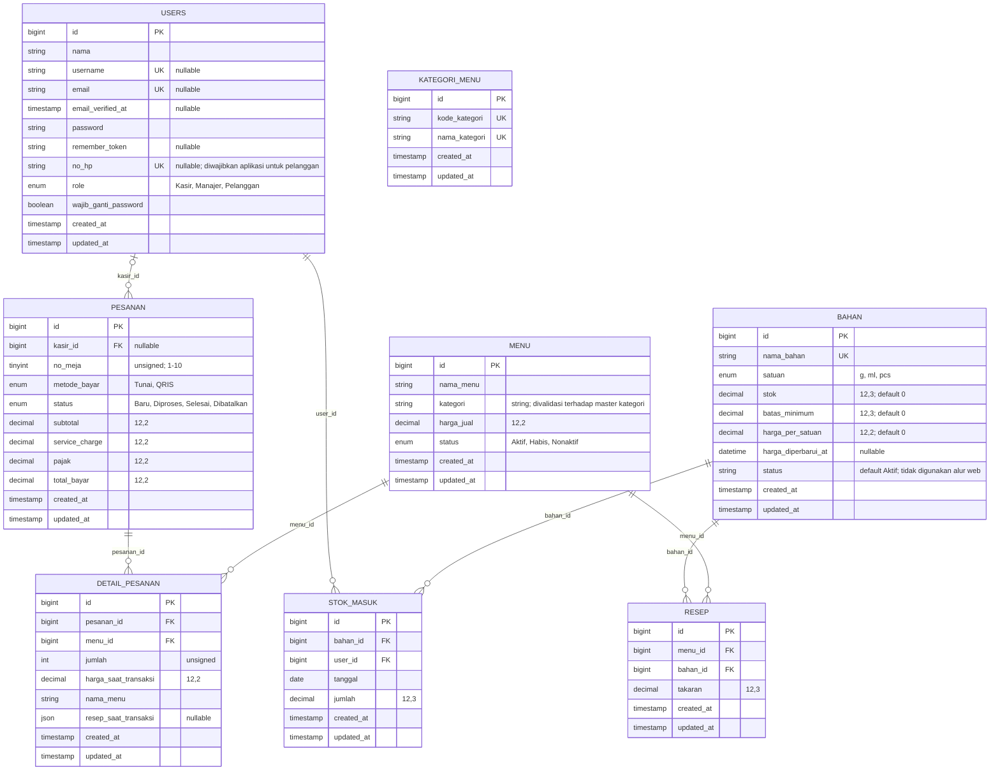

# ERD Implementasi Web Kedai Kopi Senja

ERD ini mencerminkan skema migration yang dipakai aplikasi web saat ini. Tidak ada relasi pesanan ke pelanggan: pesanan web dicatat oleh Kasir. Akun dengan peran `Pelanggan` tetap ada untuk data demo dan fitur reset password oleh Kasir.

Catatan skema dan perilaku:

- `menu.kategori` disimpan sebagai string dan divalidasi terhadap `kategori_menu` oleh aplikasi; migration tidak membuat foreign key di antara keduanya.
- Tabel `bahan` memiliki kolom `status` dari migration, tetapi model dan alur web tidak menggunakannya.
- `pesanan` tidak memiliki `pelanggan_id`. Nomor meja tidak unik; beberapa pesanan dapat menggunakan meja yang sama.
- Detail pesanan menyimpan snapshot nama menu, harga, dan resep saat transaksi.
- Pasangan `resep.menu_id` + `resep.bahan_id` unik; takaran resep dan jumlah stok masuk harus positif.
- Stok, batas minimum, harga, subtotal, biaya, dan total dibatasi agar tidak negatif; nomor meja dibatasi 1–10.
- Resep terhapus saat menu dihapus; bahan yang masih dipakai resep dan menu yang sudah tercatat pada detail pesanan tidak dapat dihapus.
- Detail pesanan terhapus saat pesanan dihapus. `pesanan.kasir_id` menjadi `NULL` saat user Kasir dihapus; riwayat stok masuk membatasi penghapusan user/bahan yang dirujuk.
