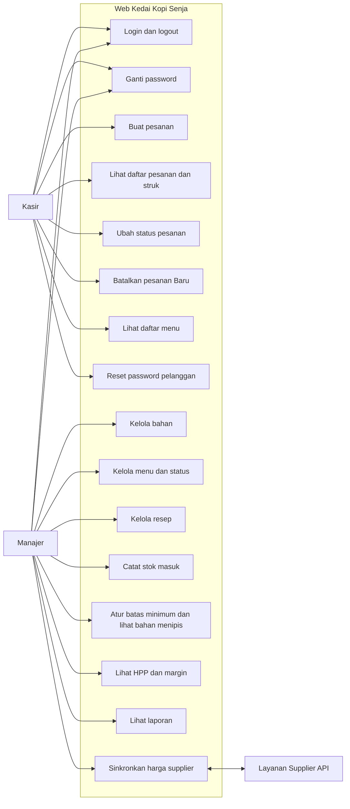
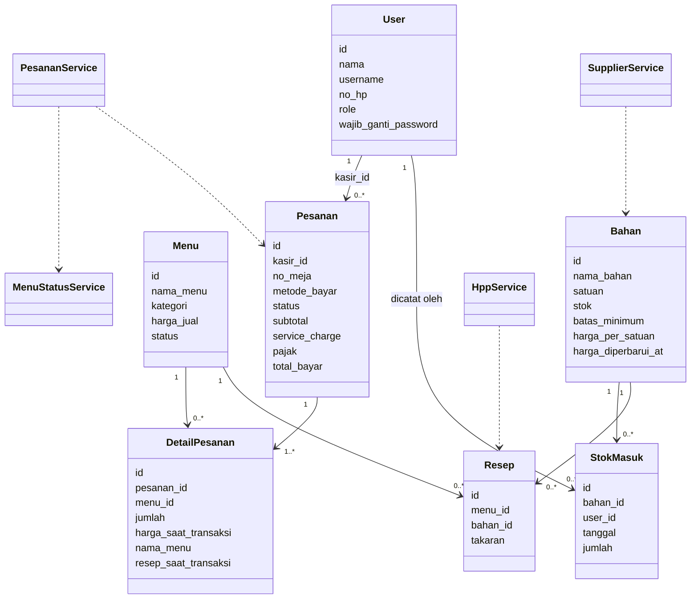

# UML Implementasi Web Kedai Kopi Senja

Dokumen ini menggambarkan fitur yang benar-benar tersedia pada web Kasir dan Manajer. Aplikasi pelanggan, pemesanan pelanggan, dan REST API pelanggan tidak termasuk lingkup implementasi ini. Diagram raster di folder ini merupakan materi rancangan awal dan masih dapat menampilkan alur APK.

## Use case web

## Class dan relasi domain

Catatan:

- Akun pelanggan demo tersimpan sebagai `User` berperan `Pelanggan` agar Kasir dapat mencari dan mereset password-nya. Pesanan web tidak berelasi dengan pelanggan.
- Beberapa pesanan boleh menggunakan nomor meja yang sama; pembatasan meja hanya 1–10.
- Pembatalan pesanan `Baru` oleh Kasir mengembalikan stok menggunakan resep terkini, sesuai keputusan yang dicatat di README.
